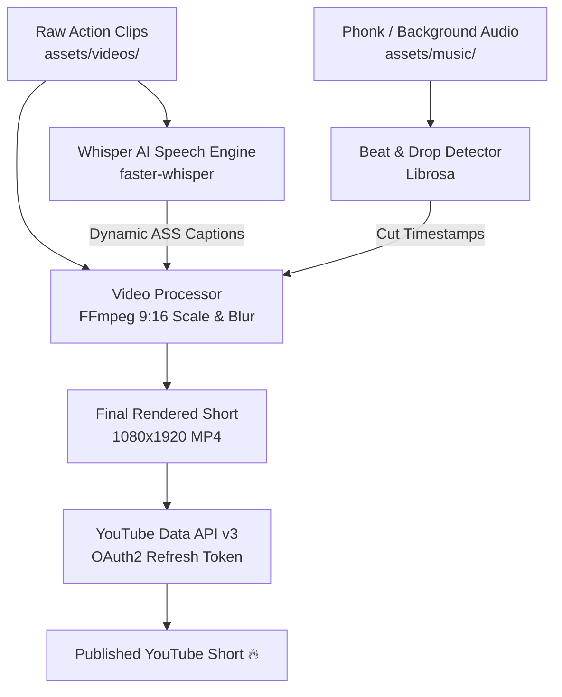

# 🎬 Automated YouTube Shorts AI Pipeline

পাইথন (Python), এফএফএমপেগ (FFmpeg), হুইস্পার এআই (OpenAI Whisper) এবং গিটহাব অ্যাকশনস (GitHub Actions) ব্যবহার করে সিনেমা বা অ্যাকশন ভিডিও থেকে স্বয়ংক্রিয়ভাবে ট্রেন্ডিং মিউজিকের বিট অনুযায়ী ৯:১৬ (Vertical) ইউটিউব শর্টস (YouTube Shorts) তৈরি ও স্বয়ংক্রিয়ভাবে ইউটিউবে আপলোড করার সম্পূর্ণ ওপেন-সোর্স অটোমেশন ফ্রেমওয়ার্ক।

---

## 📌 মূল ফিচারসমূহ (Key Features)

* 🎵 **মিউজিক বিট ও ড্রপ সিঙ্ক (Beat & Drop Sync):** `Librosa` অডিও অ্যানালাইসিস ব্যবহার করে ব্যাকগ্রাউন্ড মিউজিক বা ফোনক (Phonk)-এর ড্রপ ও বিট অনুযায়ী সিন ট্রানজিশন ও কাট তৈরি।
* 📱 **৯:১৬ ভার্টিক্যাল ফরম্যাটিং (9:16 Shorts/TikTok Layout):** যেকোনো হরিজন্টাল (16:9) সিনেমা ক্লিপকে ব্লার ব্যাকগ্রাউন্ড (Cinematic Blur Background) অথবা স্মার্ট সেন্টার ক্রপ (Center Crop)-এ রূপান্তর।
* 🗣️ **হুইস্পার এআই অটো-ক্যাপশন (Whisper AI Subtitles):** ডায়ালগের জন্য `faster-whisper` দিয়ে ভয়েস রিকগনিশন করে টিকটক/শর্টস স্টাইলের বোল্ড এবং কালারফুল ডায়নামিক সাবটাইটেল (ASS format) তৈরি ও বার্ন।
* 🚀 **হেডলেস অটো ইউটিউব আপলোড (Headless YouTube Upload):** `YouTube Data API v3` এবং ওঅথ২ রিফ্রেশ টোকেন (OAuth2 Refresh Token) ব্যবহার করে কোনো ব্রাউজার পপআপ ছাড়াই স্বয়ংক্রিয়ভাবে ভিডিও আপলোড।
* ☁️ **গিটহাব অ্যাকশনস সিআই/সিডি (GitHub Actions CI/CD):** কোনো লোকাল পিসি চালু না রেখে ক্লাউডে সম্পূর্ণ ফ্রিতে প্রতিদিন নির্দিষ্ট সময়ে (Daily Cron Job) বা এক ক্লিকে (Manual Trigger) ভিডিও রেন্ডার ও আপলোড।

---

## 🏗️ পাইপলাইন আর্কিটেকচার (Workflow Diagram)



---

## 📁 ফাইল ও ফোল্ডার ডিরেক্টরি (Project Structure)

```text
UK ai short/
├── .github/
│   └── workflows/
│       └── main.yml           # গিটহাব অ্যাকশনসের অটোমেশন ওয়ার্কফ্লো
├── assets/
│   ├── videos/                # আপনার র' অ্যাকশন ভিডিও ক্লিপগুলো এখানে রাখুন
│   ├── music/                 # ট্রেন্ডিং ফোনক বা ব্যাকগ্রাউন্ড অডিও (.mp3, .wav)
│   └── fonts/                 # কাস্টম ফন্ট (যেমন: Montserrat-Bold.ttf)
├── output/                    # চূড়ান্ত রেন্ডার হওয়া ভিডিও সংরক্ষিত হবে এখানে
├── src/
│   ├── __init__.py
│   ├── config.py              # ভিডিও সাইজ, সাবটাইটেল স্টাইল ও কনফিগারেশন
│   ├── beat_detector.py       # মিউজিক বিট ট্র্যাকিং ও ড্রপ ডিটেকশন
│   ├── subtitle_engine.py     # হুইস্পার এআই সাবটাইটেল ও ASS জেনারেটর
│   ├── video_processor.py     # ৯:১৬ ক্রপিং, ট্রানজিশন ও এফএফএমপেগ রেন্ডারিং
│   └── uploader.py            # ইউটিউব শর্টস হেডলেস আপলোডার
├── scripts/
│   ├── generate_token.py      # এককালীন ইউটিউব রিফ্রেশ টোকেন জেনারেটর স্ক্রিপ্ট
│   └── test_pipeline.py       # পাইপলাইন ও ডিপেনডেন্সি টেস্টিং টুল
├── main.py                    # মূল এক্সিকিউশন ফাইল
├── requirements.txt           # প্রয়োজনীয় পাইথন প্যাকেজের তালিকা
├── .env.example               # এনভায়রনমেন্ট ভেরিয়েবল টেমপ্লেট
├── .gitignore
└── README.md
```

---

## 🛠️ সেটআপ ও কনফিগারেশন নির্দেশিকা (Setup Guide)

### ১. গুগল ক্লাউড কনসোল ও ইউটিউব এপিআই সেটআপ (Google Cloud Setup)

1. [Google Cloud Console](https://console.cloud.google.com/)-এ যান এবং একটি নতুন প্রজেক্ট তৈরি করুন।
2. **APIs & Services** > **Library**-এ গিয়ে **YouTube Data API v3** সার্চ করে **Enable** করুন।
3. **APIs & Services** > **OAuth consent screen**-এ যান:
   * User Type দিন **External**।
   * অ্যাপের নাম ও সাপোর্ট ইমেইল দিয়ে সেভ করুন।
   * **Scopes** সেকশনে `.../auth/youtube.upload` স্কোপ যুক্ত করুন।
   * **Test users**-এ আপনার নিজস্ব ইউটিউব চ্যানেলের গুগল অ্যাকাউন্ট (Gmail) যুক্ত করুন।
4. **APIs & Services** > **Credentials**-এ যান:
   * **Create Credentials** > **OAuth client ID** সিলেক্ট করুন।
   * Application type দিন **Desktop app**।
   * তৈরি হওয়ার পর আপনার `Client ID` এবং `Client Secret` কপি করুন।

---

### ২. ইউটিউব রিফ্রেশ টোকেন সংগ্রহ (Generate Refresh Token)

গিটহাব অ্যাকশনস যেহেতু ক্লাউডে কোনো ব্রাউজার ছাড়া (Headless) রান হয়, তাই নিরবচ্ছিন্ন আপলোডের জন্য একটি রিফ্রেশ টোকেন প্রয়োজন।

১. ডিপেনডেন্সি ইন্সটল করুন:
```bash
pip install -r requirements.txt
```

২. টোকেন জেনারেটর স্ক্রিপ্টটি রান করুন:
```bash
python scripts/generate_token.py
```
* টার্মিনালে আপনার `Client ID` এবং `Client Secret` প্রদান করুন।
* স্বয়ংক্রিয়ভাবে আপনার ব্রাউজার ওপেন হবে। আপনার ইউটিউব একাউন্ট দিয়ে লগইন করে পারমিশন দিন।
* স্ক্রিপ্টটি টার্মিনালে একটি `YOUTUBE_REFRESH_TOKEN` প্রিন্ট করবে এবং লোকাল `.env` ফাইলে তা স্বয়ংক্রিয়ভাবে সেভ করে দেবে।

---

### ৩. গিটহাব সিক্রেটস সেটআপ (GitHub Secrets Setup)

আপনার গিটহাব রিপোজিটরি ক্লাউডে অটোমেশন রান করার জন্য সিক্রেটস যুক্ত করুন:

1. আপনার গিটহাব রিপোজিটরিতে যান।
2. **Settings** > **Secrets and variables** > **Actions** ট্যাবে ক্লিক করুন।
3. **New repository secret** বাটনে ক্লিক করে নিচের ৩টি সিক্রেট যোগ করুন:

| সিক্রেটের নাম (Name) | মান (Value) |
|---|---|
| `YOUTUBE_CLIENT_ID` | গুগল ক্লাউড থেকে পাওয়া Client ID |
| `YOUTUBE_CLIENT_SECRET` | গুগল ক্লাউড থেকে পাওয়া Client Secret |
| `YOUTUBE_REFRESH_TOKEN` | `generate_token.py` থেকে পাওয়া Refresh Token |

---

## 💻 লোকাল কম্পিউটারে রান করার নিয়ম (Local Usage)

### ১. ভিজ্যুয়াল ওয়েব স্টুডিও (Web Studio UI - সবচেয়ে সহজ):
ব্রাউজারে সুন্দর ইন্টারফেস থেকে ভিডিও ক্লিপ ব্রাউজ, ৯:১৬ লাইভ প্রিভিউ, সাবটাইটেল স্টাইল নির্বাচন এবং ১-ক্লিকে ইউটিউবে আপলোড করতে:
* `start_studio.bat` ফাইলটিতে ডাবল ক্লিক করুন, অথবা টার্মিনালে রান করুন:
```bash
py -3.13 studio.py
```
* স্বয়ংক্রিয়ভাবে ব্রাউজারে `http://localhost:5050` ওপেন হবে।

---

### ২. ১০০% ফুল অটোমেশন (AutoPilot - কোনো ভিডিও/মিউজিক ছাড়াই):
ইন্টারনেট থেকে অটোমেটিক ভাইরাল ফুটেজ ও ব্যাকগ্রাউন্ড ফোনক মিউজিক সংগ্রহ করে শর্ট বানিয়ে আপলোড করতে:
* `run_autopilot.bat` ফাইলটিতে ডাবল ক্লিক করুন, অথবা টার্মিনালে রান করুন:
```bash
py -3.13 -m src.autopilot
```

---

### ৩. সিএলআই কমান্ডের মাধ্যমে ভিডিও রেন্ডার ও আপলোড:

* **শুধুমাত্র ভিডিও রেন্ডার করে আউটপুট দেখতে (আপলোড ছাড়া):**
```bash
py -3.13 main.py --render-only
```

* **ভিডিও রেন্ডার করে সরাসরি ইউটিউবে আপলোড করতে:**
```bash
py -3.13 main.py --privacy public
```

* **ক্রপ স্টাইল পরিবর্তন করতে:**
```bash
# সিনেমাটিক ব্লার ব্যাকগ্রাউন্ড (ডিফল্ট ও রেকমেন্ডেড)
py -3.13 main.py --crop-style blur_background

# সেন্টার জুম ক্রপ
py -3.13 main.py --crop-style center_crop
```

---

## ☁️ গিটহাব অ্যাকশনস দিয়ে স্বয়ংক্রিয়ভাবে চালানো (GitHub Actions)

* **স্বয়ংক্রিয় শিডিউল (Daily Schedule):** ডিফল্টভাবে `.github/workflows/main.yml`-এ ক্রন জব দেওয়া আছে। প্রতিদিন ইউকে/বাংলাদেশ সময় রাত ৮টায় এটি নিজে থেকেই ভিডিও প্রডিউস করে ইউটিউব শর্টসে আপলোড করবে।
* **ম্যানুয়াল রান (Manual Trigger):**
  1. আপনার গিটহাব রিপোজিটরির **Actions** ট্যাবে যান।
  2. বাম পাশের মেনু থেকে **Daily Automated YouTube Shorts Pipeline** নির্বাচন করুন।
  3. **Run workflow** বাটনে ক্লিক করে Privacy (Public/Unlisted), Crop Style ইত্যাদি নির্ধারণ করে ইনস্ট্যান্ট রান করুন।
* **ভিডিও ডাউনলোড:** প্রতিটি রান শেষে অ্যাকশনসের সামারি পেজে `generated-youtube-shorts` আর্টিক্যাক্ট থেকে রেন্ডার করা ভিডিওটি সরাসরি ডাউনলোড করে নেওয়া যাবে।

---

## ⚙️ কাস্টমাইজেশন ও সেটিংস (`src/config.py`)

* **সাবটাইটেল কালার ও ফন্ট:** `src/config.py`-তে গিয়ে `SUBTITLE_PRIMARY_COLOR` (যেমন: হলুদ `&H0000FFFF`, সাদা `&H00FFFFFF`), ফন্ট সাইজ এবং আউটলাইন পরিবর্তন করতে পারবেন।
* **ভিডিও সময়সীমা:** `MAX_VIDEO_DURATION = 58.0` (ইউটিউব শর্টসের জন্য ৬০ সেকেন্ডের নিচে থাকা নিশ্চিত করা আছে)।
* **টাইটেল ও ট্যাগ:** ডিফল্ট টাইটেল প্রিফিক্স ও ভাইরাল হ্যাশট্যাগ কনফিগ ফাইলে বা `.env`-এ পরিবর্তন করা যাবে।
